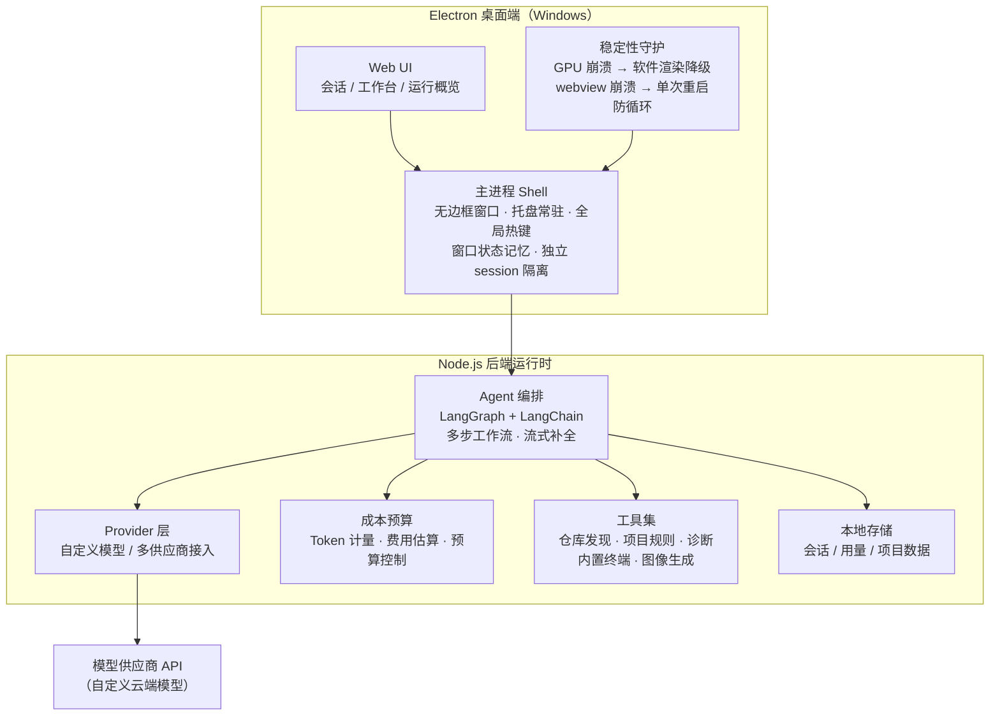
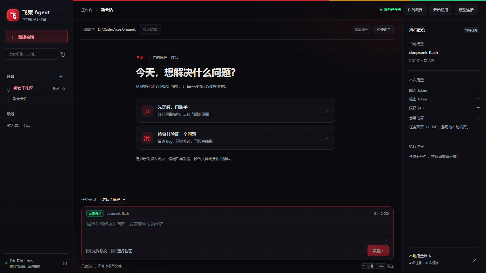
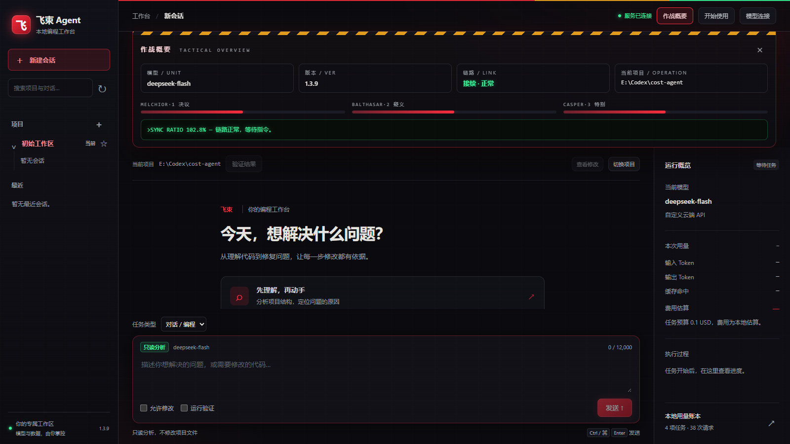

# MAYSIS · 本地 AI 编程工作台

> 产品名「飞束 Agent」，内部代号 `cost-agent`。一个跑在 Windows 桌面上的本地 AI 编程工作台：以 **LangGraph** 编排多步编程 Agent，支持**自定义模型接入**，内置**成本预算控制**，Electron 桌面端交付，已迭代至 **v1.4.x**。

> ⚠️ **脱敏说明**：本仓库为作品集展示仓，仅包含架构说明与运行截图，**不含任何源代码、配置与密钥**。项目为实习期间研发，源码归属公司，本展示仓由个人维护、仅作求职作品集用途。

---

## 核心特性

| 能力 | 说明 |
| --- | --- |
| 多步 Agent 编排 | 基于 **LangGraph + LangChain** 构建编程 Agent 工作流：理解项目结构 → 定位问题 → 修改代码 → 运行验证，逐步有依据 |
| 自定义模型接入 | provider 层支持多供应商与自定义云端 API，流式补全输出 |
| 成本预算控制 | `budget / costs` 模块逐任务计量输入/输出 Token 与缓存命中，任务前费用估算，超限可控 |
| 会话与项目管理 | 多项目工作区、会话持久化、任务类型（对话/编码）与「只分析不修改」「允许修改 + 运行验证」等执行边界开关 |
| 工程配套 | 项目规则注入、仓库自动发现、诊断模块、内置终端、图像生成 |

## 架构

## 运行实录

> 截图取自 v1.3.x 实机运行（机甲风主题 UI）。

*工作台首页：新建会话、任务类型与执行边界、运行概览（当前模型 / Token 用量 / 费用估算 / 本地使用报告）。*

*「作战概要」面板：当前模型、版本、链路状态与同步比率检查。*

## 发布工程

- **双形态发布**：NSIS 安装包（`Setup.exe`）+ 便携版（免安装目录），v1.3.1 → v1.4.x 持续迭代
- **逐文件校验**：发布物附带 SHA-256 校验清单
- **构建溯源**：`build-provenance.json` 记录版本、源码提交、后端文件摘要与 UI 产物哈希，可审计复现

## 技术栈

| 层 | 技术 |
| --- | --- |
| Agent 编排 | LangGraph · LangChain |
| 桌面端 | Electron · 无边框窗口 / 托盘 / 全局热键 |
| 后端 | Node.js（ESM）· TypeBox（结构化 Schema） |
| 发布 | NSIS · 便携版装配 · SHA-256 校验 · 构建溯源 |

## 相关仓库

- 求职作品集其他项目：[CareerPilot / CN-students-JOB](https://github.com/1345815/CN-students-JOB)
